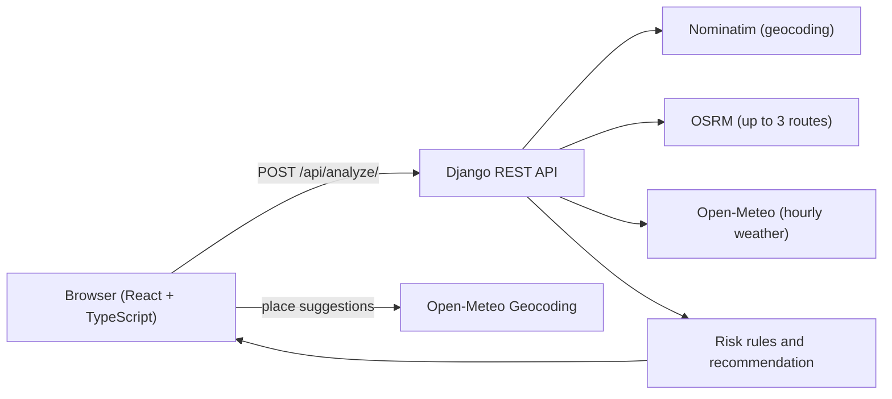

# Weather-Aware Truck Routing

A React + Django web app that helps a truck driver choose the safest of up to three driving routes, based on **weather risk, load weight and travel time**.

- **Live app:** https://weather-routing-three.vercel.app/
- **API health check:** https://weather-routing-api-624x.onrender.com/api/health/
- **Source code:** https://github.com/YOUR-USERNAME/weather-routing
- **Video walkthrough (Loom):** ADD-LOOM-LINK-HERE

> [!NOTE]
> The backend runs on a free hosting plan that goes to sleep when idle. The first request after a quiet period can take 15 to 60 seconds. The app wakes the server as soon as the page opens, so by the time the form is filled in it is usually ready. See [Known limitations](#13-known-limitations).

## Contents

1. [What it does](#1-what-it-does)
2. [Quick start for reviewers](#2-quick-start-for-reviewers)
3. [Assignment requirements and where they live](#3-assignment-requirements-and-where-they-live)
4. [How it works](#4-how-it-works)
5. [Risk rules and route recommendation](#5-risk-rules-and-route-recommendation)
6. [Tech stack and free APIs](#6-tech-stack-and-free-apis)
7. [Project structure](#7-project-structure)
8. [Run it locally](#8-run-it-locally)
9. [API reference](#9-api-reference)
10. [Testing](#10-testing)
11. [Deployment](#11-deployment)
12. [Assumptions and design decisions](#12-assumptions-and-design-decisions)
13. [Known limitations](#13-known-limitations)
14. [Possible next steps](#14-possible-next-steps)
15. [Credits and data licences](#15-credits-and-data-licences)

---

## 1. What it does

The user enters an **origin and destination**, a **departure date and time** and a **load weight** (pounds). The app then:

1. Gets **three route options** from a routing API.
2. Places **weather checkpoints** along each route (every 10, 25 or 50 miles depending on trip length) and estimates the **truck's arrival time** at each one.
3. Reads the **hourly forecast for each checkpoint at its arrival time**.
4. Classifies the weather as **Low, Moderate, High, Severe or No Travel** using the assignment's thresholds and load rules.
5. **Recommends the best route**, balancing weather risk and travel time, and explains the choice in plain language.
6. Shows all routes, checkpoints, risk levels, ETAs and route summaries on a **map**.
7. Shows a **weather heatmap along the trip corridor** with a **0 to 48 hour forecast slider**.

## 2. Quick start for reviewers

1. Open the live app: https://weather-routing-three.vercel.app/
2. In **Origin** type `dal` and pick *Dallas, Texas, United States*. In **Destination** type `okl` and pick *Oklahoma City, Oklahoma, United States*.
3. Choose a departure time, enter a load such as `42000`, and press **Analyze routes**.

Things to try:

- Click the route cards or the route lines to switch routes; the checkpoint table follows the selected route.
- Click a coloured dot on the map to see the ETA, wind, rain, snow and risk at that checkpoint.
- Drag the **forecast slider** to see the heat bands change hour by hour.
- Compare a light load (`20000`) with a heavy load (`45000`) in windy weather. The heavy-load rules raise the risk (the checkpoint table says "load rule" when they do).
- Enter a place that does not exist to see the error handling.

Results depend on the live weather, so a calm day shows all green. A rainy region such as Seattle to Portland is more likely to show risk.

## 3. Assignment requirements and where they live

| Requirement | Implementation |
|---|---|
| Inputs: origin and destination, departure date/time, load weight | `frontend/src/components/TripForm.tsx`, `LocationInput.tsx`; validated in `frontend/src/lib/validation.ts` and `backend/routing/serializers.py` |
| 3 route options from a routing API | `backend/routing/services/route_provider.py` (OSRM, with a fallback that adds detour routes) |
| Sample weather every 10 / 25 / 50 miles at the truck's ETA | `checkpoints.py` (spacing and ETAs), `weather.py`, `route_analysis.py` |
| Weather risk from the provided risk and load rules | `risk.py` |
| Recommend the best route, balancing risk and travel time | `recommendation.py` |
| Map with routes, checkpoints, risk levels, ETAs and summaries | `RouteMap.tsx`, `RouteCard.tsx`, `CheckpointTable.tsx`, `RecommendationBanner.tsx` |
| Weather heatmap with a 0 to 48 hour slider | Backend `heatmap.py`; frontend `lib/heatmap.ts`, `HeatmapLayer.tsx`, `HeatmapSlider.tsx`, `MapPanel.tsx` |
| Free third-party APIs only | OSRM, Nominatim, Open-Meteo, Open-Meteo Geocoding |
| Deliverables | This repository, the hosted app (Vercel + Render), the Loom walkthrough |

## 4. How it works



The whole pipeline is in `backend/routing/services/trip_planner.py`:

1. **Geocode** both places with Nominatim (cached 24 hours, at most one request per second).
2. **Routes:** ask OSRM for alternatives. If it returns fewer than three, extra candidates are created by routing through a waypoint beside the main route. A detour is kept only if it is at most 1.75 times slower than the fastest route and differs by more than 0.5 percent in distance or time.
3. **Checkpoints:** spacing is chosen by trip length (10 miles up to 150, 25 miles up to 500, 50 miles beyond). The ETA at each checkpoint is the departure time plus the route duration, scaled by the share of the route completed.
4. **Weather:** one batched Open-Meteo request covers every checkpoint of every route. For each checkpoint the forecast hour nearest to its ETA is used.
5. **Risk:** each checkpoint is classified (see below).
6. **Analysis:** miles per risk level and a mile-weighted average risk are computed for each route.
7. **Recommendation:** routes are ranked and the choice is explained.
8. **Heatmap data:** for each route and each hour from 0 to 48 after departure, the risk at every checkpoint is computed with the same risk function.

## 5. Risk rules and route recommendation

### Thresholds (from the assignment)

| Condition | Low | Moderate | High | Severe | No Travel |
|---|---|---|---|---|---|
| Wind (mph) | < 25 | 25 to 34 | 35 to 44 | 45 to 54 | >= 55 |
| Rain (in/hr) | < 0.10 | 0.10 to 0.25 | 0.25 to 0.50 | 0.50 to 1.00 | > 1.00 |
| Snow (in/hr) | < 0.5 | 0.5 to 1.0 | 1.0 to 2.0 | 2.0 to 3.0 | > 3.0 |

Edge values: wind bands start at their lower bound (25 mph is Moderate, 34.5 mph is still Moderate, 55 mph is No Travel). For rain and snow the table marks the open ends (`< 0.10`, `> 1.00`, `> 3.0`), so a value exactly on a shared edge belongs to the lower band (0.25 in/hr is Moderate, 1.00 in/hr is Severe). The code is in `backend/routing/services/risk.py`, and the tests cover every boundary.

### Load rules

- Wind of 55 mph or more is **No Travel** for any load.
- Wind of 45 to 54 mph with a load over 30,000 lb is **No Travel**.
- Wind of 35 to 44 mph with a load over 40,000 lb is **Severe**.

The overall level of a checkpoint is the worst of wind, rain and snow, after the load rules. The API reports the main factor and whether a load rule raised the level.

### Recommendation

Routes are compared in this order (`backend/routing/services/recommendation.py`):

1. Fewest **No Travel** miles (added by this project, see assumptions)
2. Fewest **Severe** miles
3. Fewest **High** miles
4. Lowest **average risk** (mile-weighted, from 1 for Low to 5 for No Travel)
5. Shortest **travel time**

Miles are rounded to 0.1, average risk to 0.01 and time to the minute, so tiny differences count as ties. Ties keep the fastest route first. Each checkpoint represents the road halfway to its neighbours, so the miles per risk level add up exactly to the route length. If every route crosses No Travel weather, the app says so and shows the least exposed route.

## 6. Tech stack and free APIs

| Layer | Technology |
|---|---|
| Backend | Python, Django 6, Django REST Framework, django-cors-headers, python-decouple, requests, gunicorn |
| Frontend | React, TypeScript, Vite, Leaflet, react-leaflet |
| Backend tests | pytest, pytest-django, responses (fake external APIs) |
| Frontend tests | Vitest, React Testing Library, Playwright |
| Hosting | Render (backend) and Vercel (frontend), both on free plans |

| Service | Used for | API key |
|---|---|---|
| [OSRM](https://project-osrm.org/) public demo server | Route options | None |
| [Nominatim](https://nominatim.org/) (OpenStreetMap) | Geocoding on the backend | None (identifying User-Agent required) |
| [Open-Meteo](https://open-meteo.com/) forecast API | Hourly wind, rain and snow | None |
| [Open-Meteo Geocoding](https://open-meteo.com/en/docs/geocoding-api) | Place suggestions in the browser | None |
| [OpenStreetMap](https://www.openstreetmap.org/) tiles | Map background | None |

Everything is free to use. No paid service or credit card is needed.

## 7. Project structure

```text
weather-routing/
├── README.md
├── backend/
│   ├── manage.py
│   ├── requirements.txt
│   ├── pytest.ini
│   ├── .env.example              template for the environment variables
│   ├── config/                   Django project (settings, urls, wsgi)
│   └── routing/
│       ├── views.py              the two HTTP endpoints (thin)
│       ├── serializers.py        request validation
│       ├── presenters.py         builds the JSON response
│       ├── urls.py
│       ├── services/             all business logic
│       │   ├── trip_planner.py   orchestrates the whole pipeline
│       │   ├── geocoding.py      Nominatim client (cached, rate limited)
│       │   ├── route_provider.py OSRM client and fallback routes
│       │   ├── checkpoints.py    checkpoint spacing and ETAs
│       │   ├── weather.py        Open-Meteo client (batched, cached)
│       │   ├── risk.py           thresholds and load rules
│       │   ├── route_analysis.py miles per level, average risk
│       │   ├── recommendation.py ranking and explanation
│       │   ├── heatmap.py        0 to 48 hour heatmap frames
│       │   ├── geo.py            distance and polyline maths
│       │   ├── entities.py       data classes
│       │   └── exceptions.py     error types with HTTP status codes
│       └── tests/                unit and integration tests
└── frontend/
    ├── e2e/                      Playwright tests
    ├── .env.example
    └── src/
        ├── App.tsx, main.tsx, index.css
        ├── api/                  client.ts (backend), places.ts (suggestions)
        ├── components/           form, map, heat layer, slider, cards, table
        ├── hooks/                useTripAnalysis, useLocationSuggestions
        ├── lib/                  validation, formatting, risk colours, heatmap maths
        ├── types/index.ts        TypeScript types of the API response
        └── test/                 test setup and shared fixtures
```

Design rule: views stay thin, and all business logic lives in `services/` as small modules with one job each, so the risk and recommendation logic can be tested on its own.

## 8. Run it locally

**Prerequisites:** Python 3.12 or newer, Node.js 20 or newer, Git.

### Backend

Windows PowerShell:

```powershell
cd backend
python -m venv venv
venv\Scripts\Activate.ps1
pip install -r requirements.txt
Copy-Item .env.example .env
python -c "import secrets; print(secrets.token_urlsafe(50))"
```

macOS or Linux:

```bash
cd backend
python3 -m venv venv
source venv/bin/activate
pip install -r requirements.txt
cp .env.example .env
python -c "import secrets; print(secrets.token_urlsafe(50))"
```

Paste the printed key into `DJANGO_SECRET_KEY` in `backend/.env`, set your own contact in `NOMINATIM_USER_AGENT`, then start the server:

```bash
python manage.py runserver
```

The API is now at http://localhost:8000 (health check: http://localhost:8000/api/health/).

### Frontend

In a second terminal:

```bash
cd frontend
npm install
cp .env.example .env     # Windows PowerShell: Copy-Item .env.example .env
npm run dev
```

Open http://localhost:5173.

### Environment variables

| File | Variable | Purpose |
|---|---|---|
| `backend/.env` | `DJANGO_SECRET_KEY` | Django secret key (generate your own; never commit it) |
| | `DJANGO_DEBUG` | `True` locally, `False` in production |
| | `DJANGO_ALLOWED_HOSTS` | Comma-separated host names (default `localhost`) |
| | `CORS_ALLOWED_ORIGINS` | Exact frontend origin(s), for example `http://localhost:5173`, no trailing slash |
| | `NOMINATIM_USER_AGENT` | Identifies this app to Nominatim, with a real contact, as its usage policy requires |
| `frontend/.env` | `VITE_API_BASE_URL` | Backend address, for example `http://localhost:8000` |

`.env` files are ignored by Git; only the `.env.example` templates are committed. The frontend variable is configuration, not a secret, because everything in frontend code is public.

## 9. API reference

### `GET /api/health/`

Returns `{"status": "ok"}`. The frontend calls it when the page opens to wake a sleeping free-tier server.

### `POST /api/analyze/`

Request body (JSON):

```json
{
  "origin": "Dallas, Texas, United States",
  "destination": "Oklahoma City, Oklahoma, United States",
  "departure_time": "2026-10-28T14:00:00Z",
  "load_weight_lb": 42000
}
```

| Field | Rule |
|---|---|
| `origin`, `destination` | Text, at most 200 characters; geocoded by the backend |
| `departure_time` | ISO 8601 date and time, from 1 hour in the past to 7 days ahead |
| `load_weight_lb` | Whole number from 1 to 80,000 |

Response (abbreviated example):

```json
{
  "origin": { "name": "Dallas, Dallas County, Texas, United States", "lat": 32.7763, "lon": -96.7969 },
  "destination": { "name": "Oklahoma City, Oklahoma County, Oklahoma, United States", "lat": 35.4729, "lon": -97.5163 },
  "departure_time": "2026-10-28T14:00:00Z",
  "load_weight_lb": 42000,
  "recommendation": {
    "route_id": "route-1",
    "reason": "Shortest travel time (3 h 41 min vs 5 h 17 min on the next-best route).",
    "has_safe_route": true
  },
  "routes": [
    {
      "id": "route-1",
      "rank": 1,
      "is_recommended": true,
      "distance_miles": 205.6,
      "duration_seconds": 13260,
      "arrival_time": "2026-10-28T17:41:00Z",
      "checkpoint_interval_miles": 25,
      "summary": {
        "miles_by_level": { "low": 205.6, "moderate": 0.0, "high": 0.0, "severe": 0.0, "no_travel": 0.0 },
        "average_risk": 1.0,
        "worst_level": "low"
      },
      "geometry": [[32.77595, -96.79675], "..."],
      "checkpoints": [
        {
          "mile": 25.0,
          "lat": 33.05166,
          "lon": -97.00993,
          "eta": "2026-10-28T14:27:00Z",
          "weather": { "wind_mph": 4.9, "rain_in_hr": 0.0, "snow_in_hr": 0.0 },
          "risk": { "level": "low", "label": "Low", "score": 1, "factor": null, "load_adjusted": false }
        },
        "..."
      ]
    },
    "..."
  ],
  "heatmap": {
    "hours": ["2026-10-28T14:00:00Z", "... 49 timestamps, hour 0 to hour 48 ..."],
    "routes": [
      { "route_id": "route-1", "points": [[32.77595, -96.79675], "..."], "frames": [[1, 1, 1, "..."], "... one frame per hour ..."] }
    ]
  }
}
```

`frames[hour][checkpoint]` is the risk score (1 Low to 5 No Travel) for the entered load.

### Errors

All errors have the form `{"error": "message"}`; validation errors also include `"fields"`.

| Status | Meaning |
|---|---|
| 400 | Invalid input (`fields` lists the problems) |
| 404 | A place could not be found |
| 422 | No drivable route, or origin and destination are the same place |
| 502 | An outside service (geocoding, routing or weather) failed or is rate limited |

## 10. Testing

**Backend** (pytest; every outside API is faked, so the tests are fast and repeatable):

```bash
cd backend
pytest
```

- Unit tests: geometry maths, geocoding, route provider (including the fallback that adds routes), checkpoints and ETAs, weather client (units, batching, caching, errors, rate limits), risk thresholds at every boundary, load rules, route analysis, recommendation, heatmap, forecast window, CORS.
- Integration tests (`test_analyze_api.py`): the whole `/api/analyze/` pipeline with realistic Dallas to Oklahoma City data, including a storm over the fastest route (Severe for a heavy load through the load rule, High for a light load) and every error path.

**Frontend:**

```bash
cd frontend
npm test            # over 150 unit and component tests (Vitest, Testing Library)
npm run build       # TypeScript type check and production build
npm run lint
npx playwright install chromium   # first time only
npm run e2e         # 19 end-to-end tests in a real browser, network mocked
```

The end-to-end tests include one that reads the pixels of the heat canvas to prove the colours change when the slider moves.

An optional smoke test uses the real backend and real APIs (it is skipped unless requested):

```bash
# macOS / Linux
E2E_LIVE=1 npm run e2e -- e2e/live.spec.ts
# Windows PowerShell
$env:E2E_LIVE = "1"; npm run e2e -- e2e/live.spec.ts
```

## 11. Deployment

Both parts run on free plans.

**Backend on Render** (Web Service, free instance):

| Setting | Value |
|---|---|
| Root directory | `backend` |
| Build command | `pip install -r requirements.txt` |
| Start command | `gunicorn config.wsgi:application --bind 0.0.0.0:$PORT --workers 1 --threads 4 --timeout 120` |
| Environment | `PYTHON_VERSION`, `DJANGO_SECRET_KEY` (a new key), `DJANGO_DEBUG=False`, `CORS_ALLOWED_ORIGINS` (the Vercel address), `NOMINATIM_USER_AGENT` |

One worker with several threads keeps the in-memory cache and the geocoding rate limiter in one process. The long timeout allows for slow outside services. Render's own host name is trusted automatically.

**Frontend on Vercel** (Hobby plan):

| Setting | Value |
|---|---|
| Root directory | `frontend` |
| Framework | Vite (build `npm run build`, output `dist`) |
| Environment | `VITE_API_BASE_URL` = the Render address (baked in at build time) |

## 12. Assumptions and design decisions

Where the assignment was open, these choices were made:

1. **Checkpoint spacing ("every 10 / 25 / 50 miles")** is chosen by trip length: 10 miles up to 150 miles, 25 up to 500, 50 beyond.
2. **ETAs** assume a constant average speed: the share of the distance completed equals the share of the route duration elapsed.
3. **Weather inputs:** sustained 10 m wind speed (mph); rain is `rain + showers` (in/hr); snow is `snowfall` (in/hr). The forecast hour nearest to the ETA is used.
4. **Threshold edges** are handled as described in section 5.
5. **Miles per risk level:** each checkpoint represents the road halfway to its neighbours. **Average risk** is weighted by those miles.
6. **Ranking:** the assignment's four criteria in order, plus **No Travel miles first**, so a route that cannot be driven never beats one that can.
7. **Heatmap slider:** hour 0 is departure and hour 48 is 48 hours later. Risk is calculated for the entered load. Colours between checkpoints are blended along the real road geometry for a continuous look; the checkpoints are the actual data points.
8. **Heatmap technique:** coloured, blurred segments on a canvas layer instead of `leaflet.heat`, which is a density plugin. Its colours depend on zoom level and point spacing, which would make the same risk look different at different zooms.
9. **Input limits:** departure up to 7 days ahead (the free forecast range, with room for the 48 hour heatmap); load 1 to 80,000 lb as a typo guard (the US legal gross limit).
10. **Time zones:** all calculations use UTC; times are displayed in the viewer's device time zone.
11. **Missing weather values** from the API are treated as zero.
12. **No database:** nothing needs to be stored. The API is stateless and caches in memory.
13. **Place suggestions** come from the browser through Open-Meteo Geocoding (the Nominatim policy forbids autocomplete). Any text can still be typed and is geocoded by the backend.

## 13. Known limitations

### Free weather service (Open-Meteo)

The app uses only free services. Open-Meteo's free tier has these limits and trade-offs:

1. **Request limits are per IP address, and free hosting shares IP addresses.** The free API allows fewer than 600 requests per minute, 5,000 per hour and 10,000 per day from one IP address. Free hosting platforms share outbound IP addresses between many apps, so other apps can use up the quota. When that happens the weather service answers "429 Too Many Requests", and this app shows a clear message (for example "the daily rate limit was reached", HTTP 502) instead of a result. One analysis needs only a few dozen locations, so the app itself stays far below the limit.
   - **What the app does about it:** all checkpoints of all routes go in one batched request; forecasts are cached for 2 hours using a fixed 14-day window per UTC day, so trips made the same day share them; the per-minute limit is retried after 4 and 10 seconds; the exact reason is written to the server log.
   - **What it cannot do:** hourly and daily limits clear on their own (the daily one at 00:00 UTC). A production deployment would use a paid plan, a self-hosted Open-Meteo instance, or a second provider as a fallback.
2. **Non-commercial licence.** The free API may only be used for non-commercial purposes, and the data requires attribution (CC BY 4.0). This project is a hiring assessment, and the credit is shown in the app and below.
3. **Forecast range.** The service forecasts up to 16 days ahead. Departures are limited to 7 days ahead so that the ETAs and the 48 hour heatmap fit inside the cached 14-day window.
4. **Resolution and accuracy.** Values are model forecasts, not observations, on grids of a few kilometres up to tens of kilometres depending on the region, read at the checkpoint coordinates rounded to about 0.7 miles. Narrow storms, terrain effects and local gusts can be missed, and uncertainty grows with lead time.
5. **What the risk uses.** Sustained wind at 10 m (not gusts), rain and snowfall amounts. It does not include visibility, fog, ice, road surface conditions or official weather alerts. Values are hourly, so each ETA is matched to the nearest hour.
6. **No service guarantee.** If the service is down, the API returns a clear 502 message. There is no fallback provider yet.

### Other free services

- **Routing (OSRM public demo server)** uses a car profile, so routes are not truck-legal (no height, weight or hazmat restrictions) and travel times are optimistic for trucks. It is shared, best-effort and meant for light use. It sometimes returns fewer than three alternatives; the app then adds detour routes.
- **Geocoding (Nominatim)** has a strict [usage policy](https://operations.osmfoundation.org/policies/nominatim/): at most one request per second, an identifying User-Agent, caching, and no autocomplete. The app follows these. It is not suitable for heavy public traffic, and shared hosting IPs could be throttled.
- **Place suggestions** come from GeoNames data, which covers cities and towns. Street addresses can still be typed but will not appear in the suggestions.

### Hosting

- **Render free plan:** the server sleeps after 15 minutes without traffic and may restart at any time, which clears the in-memory cache. The first request after a quiet period is slow. The frontend wakes the server when the page opens. There are 750 free instance hours per month per workspace.
- **Vercel Hobby plan** is for non-commercial use.

### Modelling simplifications

- ETAs use a constant average speed from a car profile. They ignore traffic, stops, rest breaks and hours-of-service rules.
- Weather is sampled only at checkpoints (10, 25 or 50 miles apart). Weather narrower than the spacing can be missed, and risk between checkpoints is blended for display, not measured.
- Load weight means the load, not the gross vehicle weight.
- Times are shown in the viewer's device time zone, not the origin's.

### Security and operations

- The API is public and stateless, with no authentication or request throttling. CORS is limited to the configured frontend origin, input is validated, and secrets are read from environment variables. A production version would add rate limiting.

## 14. Possible next steps

- Truck-profile routing (height, weight and hazmat restrictions) with a provider or self-hosted engine.
- A second weather provider as a fallback, or self-hosted Open-Meteo, and wind gust data.
- ETAs that include rest stops, plus times shown in the origin's time zone.
- API throttling, continuous integration and basic monitoring.

## 15. Credits and data licences

- Weather data by [Open-Meteo.com](https://open-meteo.com/), licensed [CC BY 4.0](https://creativecommons.org/licenses/by/4.0/).
- Place suggestions: Open-Meteo Geocoding API, based on [GeoNames](https://www.geonames.org/) data (CC BY 4.0).
- Map data © [OpenStreetMap](https://www.openstreetmap.org/copyright) contributors. Routing by [OSRM](https://project-osrm.org/). Geocoding by [Nominatim](https://nominatim.org/).